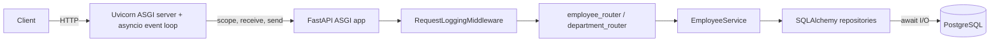

# Employee Management API

FastAPI implementation of the Employee Management spec using **hexagonal
architecture**, **PostgreSQL**, **Liquibase** (via `pyliquibase`) and structured
JSON logging.

## Tech Stack

| Layer | Technology | Version | Purpose |
|-------|------------|---------|---------|
| Language | Python | 3.12+ | Runtime |
| Web framework | FastAPI | 0.115.x | HTTP routing, request validation, OpenAPI |
| ASGI server | Uvicorn (standard) | 0.32–0.34 | Serves the ASGI app |
| Validation / settings | Pydantic / pydantic-settings | 2.9.x / 2.5.x | Request & response schemas, env-based config |
| Email validation | email-validator | 2.2.x | `EmailStr` support |
| ORM | SQLAlchemy | 2.0.x | Persistence mapping & session management |
| Database | PostgreSQL | 16 | Primary data store |
| DB driver | psycopg2-binary | 2.9.x | PostgreSQL driver |
| Migrations | Liquibase (via `pyliquibase`) | 4.21.1 / 2.x | Schema migrations (YAML changelogs) |
| Migration runtime | Java (JRE/JDK) | 17 (11+ supported) | Required by Liquibase |
| Testing | pytest / pytest-cov / httpx | 8.3.x / 5–6 / 0.27–0.28 | Unit & API tests (in-memory SQLite) |
| Tooling | Docker Compose | — | Local PostgreSQL |

Schema migrations run automatically at application startup (configurable via
`RUN_MIGRATIONS_ON_STARTUP`); see [`docs/create-employee-workflow.md`](docs/create-employee-workflow.md)
for a request-level walkthrough of the Create Employee API.

## Architecture (ports & adapters)

```
app/
├── domain/                     # Core: entities, ports (interfaces), exceptions
├── application/                # Use cases (EmployeeService)
├── adapters/
│   ├── inbound/http/           # Driving adapter: FastAPI routers, schemas, errors
│   └── outbound/persistence/   # Driven adapter: SQLAlchemy ORM + repositories
└── infrastructure/             # Config, DB session, logging, Liquibase runner
db-migrations/                  # Liquibase changelogs (YAML)
tests/                          # Domain, service and API tests
```

The domain and application layers have no framework/DB dependencies. The outside
world plugs in through the ports defined in `app/domain/ports.py`.

## Request flow (ASGI)

Every HTTP request travels through an ASGI pipeline before it reaches a router:

```
Client ──HTTP──> ASGI server (Uvicorn) ──ASGI calls──> ASGI app (FastAPI) ──> your routers
```

- **ASGI** (Asynchronous Server Gateway Interface) is the async contract between a
  web server and a Python web app. The app is an async callable
  `async def app(scope, receive, send)`; `receive`/`send` are awaitables used to
  stream request/response events.
- **Uvicorn** is the ASGI **server**: it owns a single-threaded **event loop**
  (`asyncio`), listens on the socket, parses HTTP, and drives the app. Each
  request becomes a lightweight coroutine/task on that loop rather than a thread.
- **FastAPI** is the ASGI **app**: it dispatches through middleware and
  dependencies to the matching router handler.
- **Event loop & concurrency:** at every `await` (e.g. awaiting the DB), the task
  yields control so the loop can progress other requests. Concurrency comes from
  overlapping I/O waits on one thread — so blocking work must never run directly
  on the loop. Plain `def` handlers are offloaded to a threadpool; `async def`
  handlers run on the loop.
- **Lifespan:** Uvicorn emits ASGI `lifespan` startup/shutdown events on the same
  loop — that is where [`app/main.py`](app/main.py) runs Liquibase migrations
  before serving traffic.



`RequestLoggingMiddleware` ([`middleware.py`](app/adapters/inbound/http/middleware.py))
sits at the top of this pipeline: it assigns an `x-request-id`, awaits
`call_next(request)` (a yield point for the event loop), and logs method, path,
status, and latency for each request.

## Prerequisites

- Python 3.12+
- Docker (for PostgreSQL) — or an existing PostgreSQL instance
- A Java runtime (JRE 11+) on `PATH` — required by Liquibase

## Setup

```powershell
python -m venv .venv
.\.venv\Scripts\Activate.ps1
pip install -r requirements.txt
Copy-Item .env.example .env
```

## Start the database

```powershell
docker compose up -d
```

## Run database migrations (Liquibase)

```powershell
python -m app.infrastructure.migrations
```

This applies the changelogs in `db-migrations/changelog-master.yaml` and seeds a few departments.

## Run the API

```powershell
uvicorn app.main:app --reload
```

- Swagger UI: http://localhost:8000/docs
- OpenAPI JSON: http://localhost:8000/openapi.json
- Health check: http://localhost:8000/health

## Run tests

```powershell
pytest
```

Tests run against an in-memory SQLite database, so neither Docker nor Java are
required to execute them.

## Endpoints

| Method | Path | Description |
|--------|------|-------------|
| POST   | `/api/v1/employees` | Create employee |
| GET    | `/api/v1/employees/{id}` | Get employee by id |
| PUT    | `/api/v1/employees/{id}` | Update employee |
| PUT    | `/api/v1/employees/{id}/departments` | Replace department assignments |
| DELETE | `/api/v1/employees/{id}` | Delete employee |
| GET    | `/api/v1/departments/{id}/employees` | List employees in a department |

Errors follow the standard shape:

```json
{ "error": { "code": "DEPARTMENT_NOT_FOUND", "message": "Department '9' not found" } }
```
