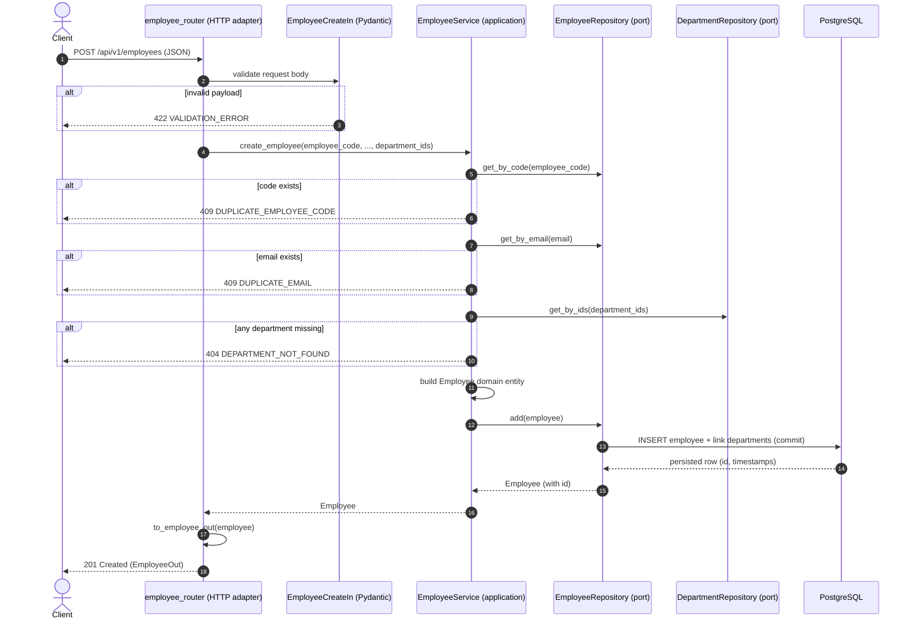

# Create Employee API — Workflow

Request-level walkthrough of `POST /api/v1/employees`, showing how a request
flows through the hexagonal layers (inbound HTTP adapter → application service →
domain → outbound persistence adapter) and back.

## Endpoint

| Item | Value |
|------|-------|
| Method | `POST` |
| Path | `/api/v1/employees` |
| Success status | `201 Created` |
| Request model | `EmployeeCreateIn` |
| Response model | `EmployeeOut` |

### Request body

```json
{
  "employee_code": "EMP001",
  "first_name": "John",
  "last_name": "Doe",
  "email": "john.doe@example.com",
  "phone": "+1-555-0100",
  "department_ids": [1]
}
```

| Field | Type | Required | Rules |
|-------|------|----------|-------|
| `employee_code` | string | yes | min length 1; must be unique |
| `first_name` | string | yes | min length 1 |
| `last_name` | string | yes | min length 1 |
| `email` | string (email) | yes | valid email; must be unique |
| `phone` | string \| null | no | — |
| `department_ids` | int[] | no | each id must reference an existing department |

### Success response (`201 Created`)

```json
{
  "id": 1,
  "employee_code": "EMP001",
  "first_name": "John",
  "last_name": "Doe",
  "email": "john.doe@example.com",
  "departments": [
    { "id": 1, "name": "Engineering" }
  ]
}
```

## Component flow



## Step-by-step

1. **HTTP intake & validation** — [`employee_router.create_employee`](../app/adapters/inbound/http/employee_router.py)
   receives the request. FastAPI validates the body against
   [`EmployeeCreateIn`](../app/adapters/inbound/http/schemas.py). Malformed input
   (missing fields, invalid email, empty strings) never reaches the service — it
   is rejected with `422 VALIDATION_ERROR`.

2. **Dependency wiring** — [`get_employee_service`](../app/adapters/inbound/http/dependencies.py)
   injects an [`EmployeeService`](../app/application/services.py) backed by
   SQLAlchemy repositories bound to a request-scoped DB session
   ([`get_session`](../app/infrastructure/database.py)).

3. **Uniqueness checks** — `EmployeeService.create_employee` calls
   `get_by_code` and `get_by_email` through the `EmployeeRepository` port.
   A collision raises `DuplicateEmployeeCode` or `DuplicateEmail`.

4. **Department resolution** — `_resolve_departments` de-duplicates the supplied
   `department_ids` and loads them via `DepartmentRepository.get_by_ids`. Any id
   that does not exist raises `DepartmentNotFound`.

5. **Domain entity construction** — a pure [`Employee`](../app/domain/entities.py)
   dataclass is built (`id=None`), carrying the resolved departments. The domain
   layer has no framework or DB dependencies.

6. **Persistence** — [`SqlAlchemyEmployeeRepository.add`](../app/adapters/outbound/persistence/repositories.py)
   maps the entity to `EmployeeModel`, attaches the department links, then
   `commit()` + `refresh()` to obtain the generated `id` and timestamps. The
   persisted model is mapped back to a domain `Employee`.

7. **Response shaping** — [`to_employee_out`](../app/adapters/inbound/http/presenters.py)
   converts the domain entity to `EmployeeOut`, and the router returns
   `201 Created`.

8. **Logging** — on success the service emits a structured `employee.created`
   log event including the new `employee_id`.

## Error reference

All errors use the standard envelope:

```json
{ "error": { "code": "<CODE>", "message": "<human readable>" } }
```

| Condition | Exception | Code | HTTP |
|-----------|-----------|------|------|
| Invalid / missing fields | `RequestValidationError` | `VALIDATION_ERROR` | 422 |
| Duplicate employee code | `DuplicateEmployeeCode` | `DUPLICATE_EMPLOYEE_CODE` | 409 |
| Duplicate email | `DuplicateEmail` | `DUPLICATE_EMAIL` | 409 |
| Unknown department id | `DepartmentNotFound` | `DEPARTMENT_NOT_FOUND` | 404 |
| Unexpected failure | `Exception` | `INTERNAL_ERROR` | 500 |

Status mapping is defined in
[`error_handlers.py`](../app/adapters/inbound/http/error_handlers.py).

## Try it

```powershell
curl -X POST http://localhost:8000/api/v1/employees `
  -H "Content-Type: application/json" `
  -d '{"employee_code":"EMP001","first_name":"John","last_name":"Doe","email":"john.doe@example.com","phone":"+1-555-0100","department_ids":[1]}'
```

Or import the Postman collection at
[`postman/employee-management-api.postman_collection.json`](../postman/employee-management-api.postman_collection.json)
and run **Employees → Create employee**.
